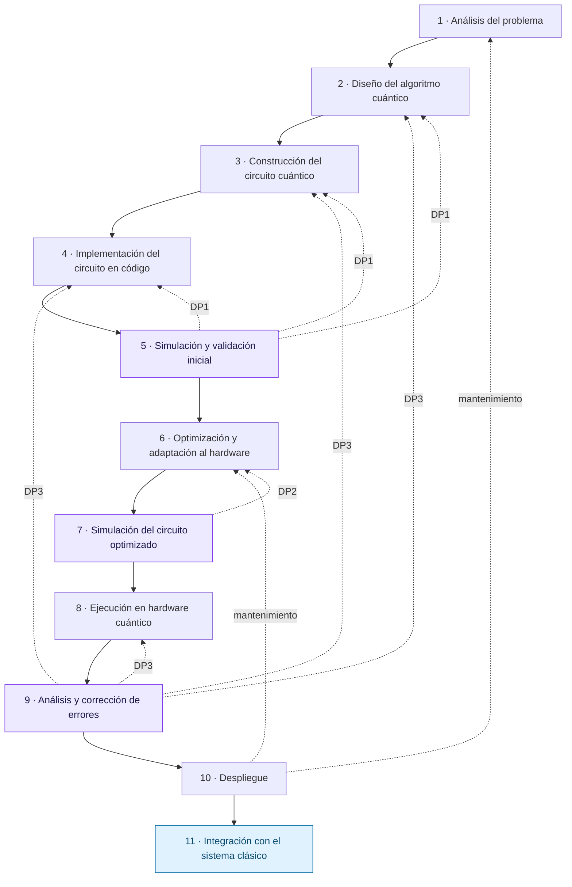
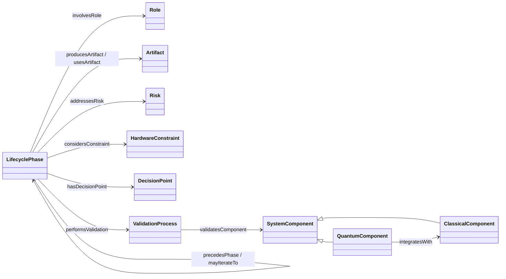

# Ontología del ciclo de vida para el desarrollo de componentes de software cuántico

Ontología OWL que formaliza un ciclo de vida de **once fases** para desarrollar el **componente cuántico** de un sistema híbrido clásico-cuántico. Representa las fases del ciclo y su secuencia, los retornos de iteración, los roles, los artefactos, los riesgos, las restricciones de hardware, los puntos de decisión, los procesos de validación y los componentes del sistema híbrido.

La ontología forma parte de la tesis de maestría *Propuesta de un Ciclo de Vida para el Desarrollo de Software Cuántico Basada en el Análisis Comparativo de Modelos Clásicos y Cuánticos* (TecNM/CENIDET).

| | |
|---|---|
| **Archivo** | [`6.- ontologia v1.owl`](6.-%20ontologia%20v1.owl) (RDF/XML) |
| **Lenguaje** | OWL 2 |
| **Editor** | Protégé |
| **Razonador** | HermiT |

---

## Contenido

- [El ciclo de vida](#el-ciclo-de-vida)
- [Estructura de la ontología](#estructura-de-la-ontología)
- [Individuos](#individuos)
- [Relaciones por fase](#relaciones-por-fase)
- [Restricciones](#restricciones)
- [Validación](#validación)
- [Cómo usarla](#cómo-usarla)

---

## El ciclo de vida

El ciclo comienza después de que el proceso del sistema define los requerimientos y decide usar un componente cuántico. Termina cuando el componente, ya desplegado, se integra con el sistema clásico.

Las flechas continuas representan la secuencia (`precedesPhase`) y las punteadas, los retornos (`mayIterateTo`). Las fases 5, 7 y 9 tienen asociado un punto de decisión (DP1, DP2 y DP3).

---

## Estructura de la ontología

### Clases

| Clase | Representa |
|---|---|
| `LifecyclePhase` | Fases del ciclo de vida |
| `Role` | Perfiles profesionales responsables de cada fase |
| `Artifact` | Productos generados o utilizados en las fases |
| `Risk` | Riesgos técnicos del desarrollo |
| `HardwareConstraint` | Restricciones impuestas por el hardware cuántico |
| `DecisionPoint` | Puntos en los que se decide avanzar o iterar |
| `ValidationProcess` | Procesos de validación mediante simulación |
| `SystemComponent` | Componentes del sistema híbrido (clase general, sin individuos propios) |
| `QuantumComponent` ⊑ `SystemComponent` | Componente cuántico |
| `ClassicalComponent` ⊑ `SystemComponent` | Componente clásico |

### Propiedades de objeto

Cada propiedad tiene definida su inversa.

| Propiedad | Dominio → rango | Inversa |
|---|---|---|
| `producesArtifact` | LifecyclePhase → Artifact | `isProducedBy` |
| `usesArtifact` | LifecyclePhase → Artifact | `isUsedBy` |
| `involvesRole` | LifecyclePhase → Role | `participatesIn` |
| `precedesPhase` | LifecyclePhase → LifecyclePhase | `followsPhase` |
| `mayIterateTo` | LifecyclePhase → LifecyclePhase | `iterationFrom` |
| `addressesRisk` | LifecyclePhase → Risk | `addressedBy` |
| `considersConstraint` | LifecyclePhase → HardwareConstraint | `constrainsPhase` |
| `hasDecisionPoint` | LifecyclePhase → DecisionPoint | `decisionPointOf` |
| `performsValidation` | LifecyclePhase → ValidationProcess | `performedIn` |
| `validatesComponent` | ValidationProcess → SystemComponent | `validatedBy` |
| `integratesWith` | QuantumComponent → ClassicalComponent | `isIntegratedWith` |

---

## Individuos

| Clase | Cantidad | Individuos |
|---|:---:|---|
| `LifecyclePhase` | 11 | `ProblemAnalysis`, `QuantumAlgorithmDesign`, `QuantumCircuitConstruction`, `CodeImplementation`, `InitialSimulationValidation`, `HardwareOptimization`, `OptimizedSimulation`, `QuantumHardwareExecution`, `ErrorAnalysisCorrection`, `Deployment`, `ClassicalSystemIntegration` |
| `Role` | 6 | `QuantumAlgorithmDesigner`, `QuantumSoftwareEngineer`, `SoftwareArchitect`, `ClassicalSoftwareEngineer`, `QuantumHardwareSpecialist`, `QualityAssuranceValidationEngineer` |
| `Artifact` | 15 | `ProblemAnalysisDocument`, `InitialRiskRegister`, `QuantumAlgorithmSpecification`, `ExperimentationPlan`, `QuantumCircuitModel`, `QuantumCircuitCode`, `InitialSimulationReport`, `QuantumTestCases`, `OptimizedQuantumCircuit`, `TechnicalRiskRegister`, `OptimizedSimulationReport`, `ExperimentalResults`, `ResultsAnalysisReport`, `DeployedQuantumSystem`, `HybridClassicalQuantumModule` |
| `Risk` | 5 | `ProblemComplexityRisk`, `QuantumAlgorithmAvailabilityRisk`, `ImplementationErrorRisk`, `HardwareLimitationRisk`, `HardwareNoiseRisk` |
| `HardwareConstraint` | 6 | `LimitedQubitAvailability`, `QubitConnectivity`, `SupportedGateSet`, `BackendAvailability`, `ExecutionLimit`, `ExecutionCost` |
| `DecisionPoint` | 3 | `InitialSimulationDecision` (DP1), `OptimizedSimulationDecision` (DP2), `ErrorAnalysisDecision` (DP3) |
| `ValidationProcess` | 2 | `InitialSimulation`, `OptimizedSimulationValidation` |
| `QuantumComponent` | 1 | `QuantumModule` |
| `ClassicalComponent` | 1 | `ClassicalSystem` |

---

## Relaciones por fase

| # | Fase | Roles | Usa | Produce |
|:---:|---|---|---|---|
| 1 | `ProblemAnalysis` | SoftwareArchitect, QuantumAlgorithmDesigner | Requerimientos del sistema clásico (externos) | ProblemAnalysisDocument, InitialRiskRegister |
| 2 | `QuantumAlgorithmDesign` | QuantumAlgorithmDesigner | ProblemAnalysisDocument, InitialRiskRegister | QuantumAlgorithmSpecification, ExperimentationPlan |
| 3 | `QuantumCircuitConstruction` | QuantumAlgorithmDesigner, QuantumSoftwareEngineer | QuantumAlgorithmSpecification, ExperimentationPlan | QuantumCircuitModel |
| 4 | `CodeImplementation` | QuantumSoftwareEngineer | QuantumCircuitModel | QuantumCircuitCode |
| 5 | `InitialSimulationValidation` | QuantumSoftwareEngineer, QualityAssuranceValidationEngineer | QuantumCircuitCode, ExperimentationPlan | InitialSimulationReport, QuantumTestCases |
| 6 | `HardwareOptimization` | QuantumSoftwareEngineer, QuantumHardwareSpecialist | QuantumCircuitCode, InitialSimulationReport | OptimizedQuantumCircuit, TechnicalRiskRegister |
| 7 | `OptimizedSimulation` | QuantumSoftwareEngineer, QualityAssuranceValidationEngineer | OptimizedQuantumCircuit, TechnicalRiskRegister | OptimizedSimulationReport |
| 8 | `QuantumHardwareExecution` | QuantumSoftwareEngineer, QuantumHardwareSpecialist | OptimizedQuantumCircuit, OptimizedSimulationReport | ExperimentalResults |
| 9 | `ErrorAnalysisCorrection` | QuantumHardwareSpecialist, QualityAssuranceValidationEngineer | ExperimentalResults, TechnicalRiskRegister | ResultsAnalysisReport |
| 10 | `Deployment` | SoftwareArchitect, ClassicalSoftwareEngineer, QualityAssuranceValidationEngineer | OptimizedQuantumCircuit, ResultsAnalysisReport | DeployedQuantumSystem |
| 11 | `ClassicalSystemIntegration` | ClassicalSoftwareEngineer, SoftwareArchitect, QuantumSoftwareEngineer | DeployedQuantumSystem | HybridClassicalQuantumModule |

### Riesgos, restricciones, decisiones y validación

| Fase | Riesgos (`addressesRisk`) | Restricciones (`considersConstraint`) | Punto de decisión | Validación |
|---|---|---|---|---|
| `ProblemAnalysis` | ProblemComplexityRisk, QuantumAlgorithmAvailabilityRisk, HardwareLimitationRisk | — | — | — |
| `QuantumAlgorithmDesign` | ProblemComplexityRisk, QuantumAlgorithmAvailabilityRisk | — | — | — |
| `CodeImplementation` | ImplementationErrorRisk | — | — | — |
| `InitialSimulationValidation` | — | — | DP1 | InitialSimulation |
| `HardwareOptimization` | HardwareLimitationRisk | LimitedQubitAvailability, QubitConnectivity, SupportedGateSet | — | — |
| `OptimizedSimulation` | — | — | DP2 | OptimizedSimulationValidation |
| `QuantumHardwareExecution` | HardwareNoiseRisk | BackendAvailability, ExecutionLimit, ExecutionCost | — | — |
| `ErrorAnalysisCorrection` | HardwareNoiseRisk | — | DP3 | — |

Ambos procesos de validación se aplican sobre `QuantumModule` (`validatesComponent`), y `QuantumModule` se integra con `ClassicalSystem` (`integratesWith`).

### Retornos (`mayIterateTo`)

| Desde | Hacia | Tipo |
|---|---|---|
| `InitialSimulationValidation` (DP1) | `QuantumAlgorithmDesign`, `QuantumCircuitConstruction`, `CodeImplementation` | Corrección |
| `OptimizedSimulation` (DP2) | `HardwareOptimization` | Corrección |
| `ErrorAnalysisCorrection` (DP3) | `QuantumAlgorithmDesign`, `QuantumCircuitConstruction`, `CodeImplementation`, `QuantumHardwareExecution` | Ajuste experimental |
| `Deployment` | `ProblemAnalysis`, `HardwareOptimization` | Mantenimiento |

---

## Restricciones

| Ámbito | Restricción (sintaxis Manchester) |
|---|---|
| Toda `LifecyclePhase` | `producesArtifact some Artifact` |
| | `usesArtifact some Artifact` |
| | `involvesRole some Role` |
| | `precedesPhase only LifecyclePhase` |
| | `mayIterateTo only LifecyclePhase` |
| | `addressesRisk only Risk` |
| | `considersConstraint only HardwareConstraint` |
| | `hasDecisionPoint max 1 DecisionPoint` |
| `ProblemAnalysis` | `followsPhase max 0 LifecyclePhase` (fase inicial) |
| `ClassicalSystemIntegration` | `precedesPhase max 0 LifecyclePhase` (fase final) |
| `InitialSimulationValidation`, `OptimizedSimulation`, `ErrorAnalysisCorrection` | `hasDecisionPoint exactly 1 DecisionPoint` |
| `HardwareOptimization` | `considersConstraint some HardwareConstraint` |
| `QuantumHardwareExecution` | `addressesRisk some Risk` |
| `Deployment` | `producesArtifact exactly 1 Artifact` |
| `QuantumComponent` | `integratesWith some ClassicalComponent` |
| `ValidationProcess` | `validatesComponent some SystemComponent` |

---

## Validación

La ontología se clasificó con el razonador **HermiT** sin inconsistencias lógicas. Después se ejecutaron once consultas DL en Protégé:

| # | Consulta DL | Resultado |
|:---:|---|---|
| 1 | `LifecyclePhase` | 11 fases |
| 2 | `producesArtifact some Artifact` | 11 fases |
| 3 | `involvesRole some Role` | 11 fases |
| 4 | `usesArtifact some Artifact` | 10 fases (todas excepto `ProblemAnalysis`, cuya entrada son los requerimientos externos) |
| 5 | `precedesPhase some LifecyclePhase` | 10 fases (todas excepto `ClassicalSystemIntegration`, fase final) |
| 6 | `mayIterateTo some LifecyclePhase` | `InitialSimulationValidation`, `OptimizedSimulation`, `ErrorAnalysisCorrection`, `Deployment` |
| 7 | `addressesRisk some Risk` | 6 fases |
| 8 | `considersConstraint some HardwareConstraint` | `HardwareOptimization`, `QuantumHardwareExecution` |
| 9 | `hasDecisionPoint some DecisionPoint` | `InitialSimulationValidation`, `OptimizedSimulation`, `ErrorAnalysisCorrection` |
| 10 | `performsValidation some ValidationProcess` | `InitialSimulationValidation`, `OptimizedSimulation` |
| 11 | `QuantumComponent` | `QuantumModule` |

> La validación es conceptual, estructural y semántica: muestra que el ciclo puede representarse de forma consistente y consultable. No constituye una evaluación empírica de su aplicación en proyectos reales.

---

## Cómo usarla

1. Descarga o clona el repositorio.
2. Abre `6.- ontologia v1.owl` en [Protégé](https://protege.stanford.edu/) (versión 5.x).
3. Activa el razonador en **Reasoner → HermiT → Start reasoner**.
4. En la pestaña **DL Query**, escribe una consulta de la tabla anterior, marca **Instances** y da clic en **Execute**.
